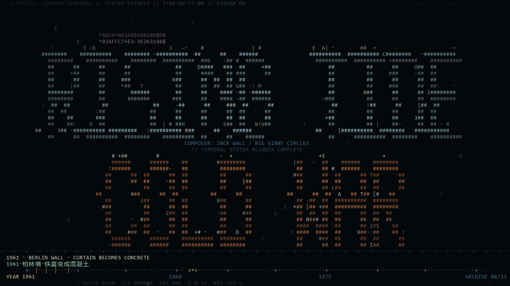
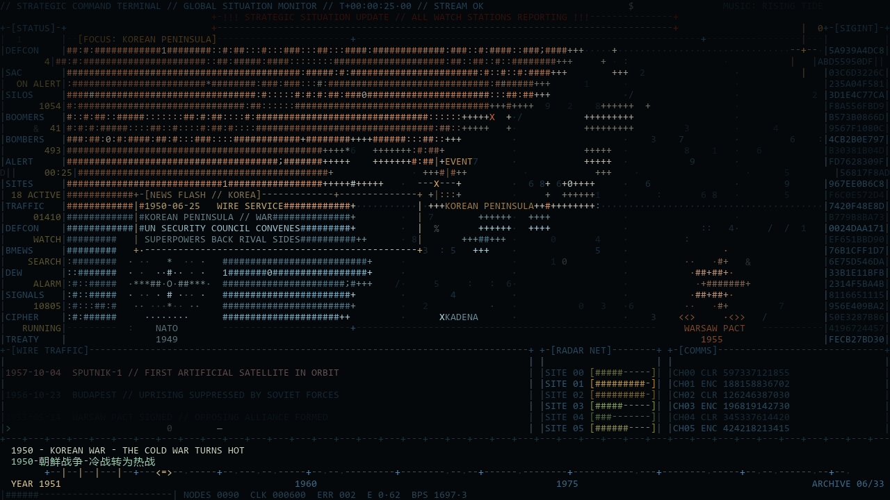
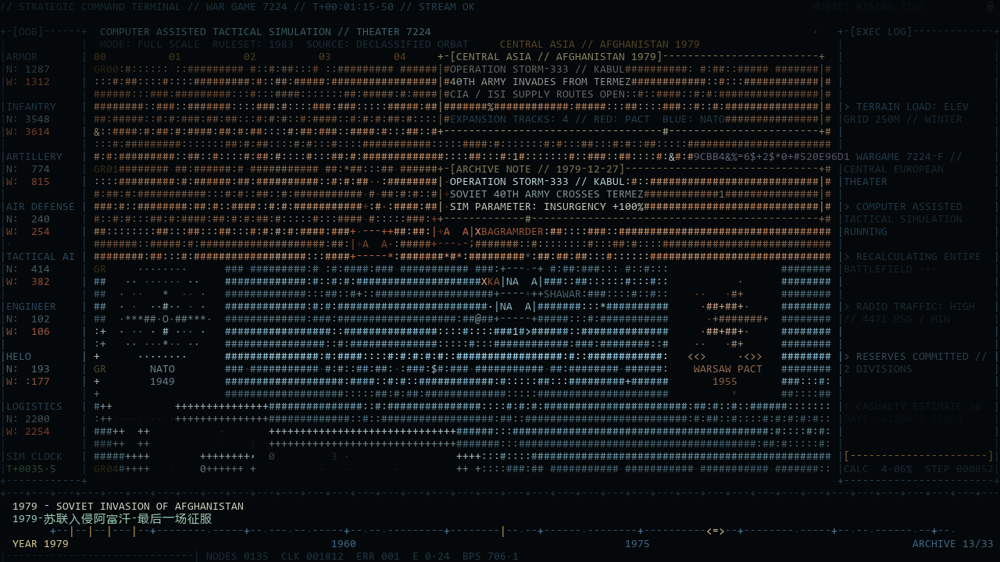
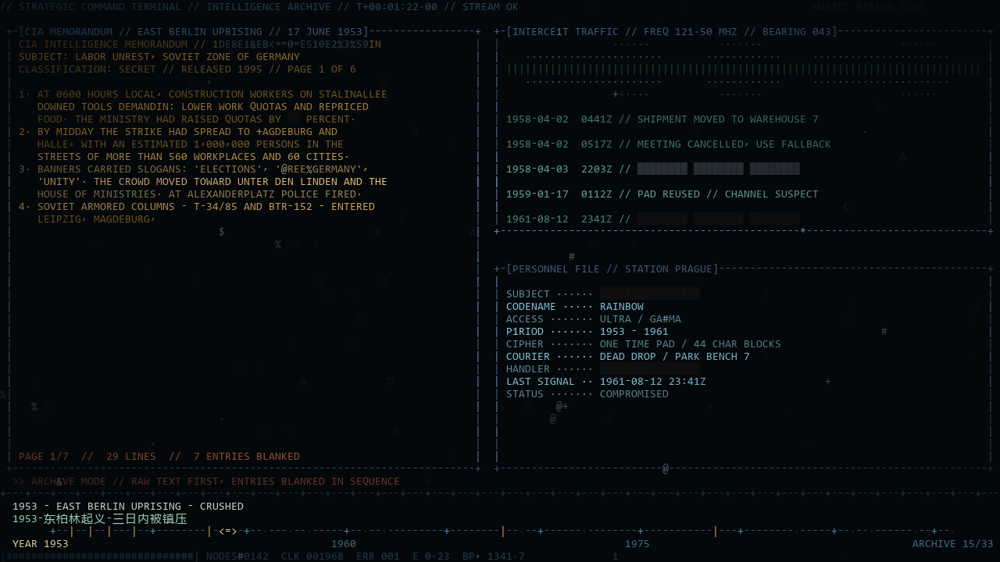
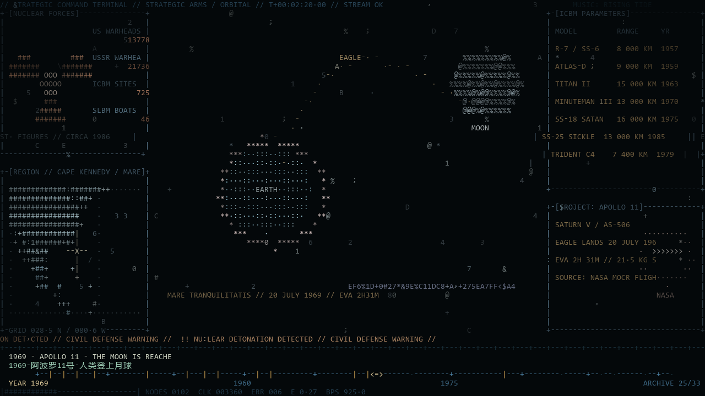
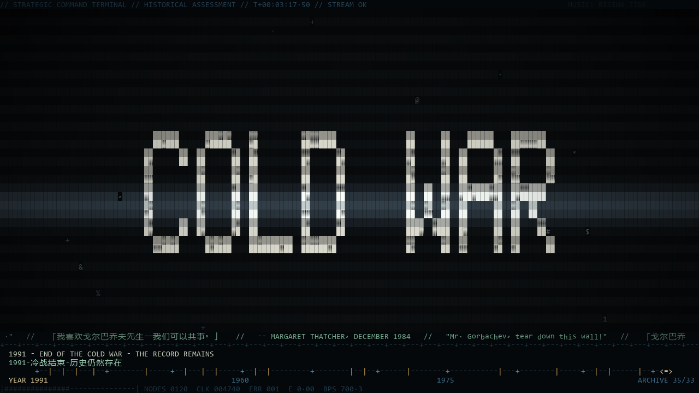

# Rising Tide —ascii



Jack Wall、Big Giant Circles《Rising Tide》的字符动画 MV。冷战题材、军事终端视觉、
中英双语字幕 + 1945–1991 历史时间线、与原曲节拍和段落逐帧同步。

整个画面是一台"正在运行的冷战计算机系统"：世界局势监控、字符爆散重构标题、
兵棋推演、情报暗战、核军备与太空竞赛、冷战尾声、历史评价——全部由 ASCII 字符、
数据流、终端窗口与 CRT 效果构成。

## 创作提示词

整理了这支 MV 从初始构想到逐段调整的 **10 轮提示词**，以及一份方便复用的合并版。

- **[创作提示词与调整记录](docs/prompts/creation-prompts.md)**：初始提示词、逐轮修改需求、文末合并版。

## 演示

| | |
| --- | --- |
|  |  |
| 世界局势监控：新闻弹窗、阵营徽标、时间线字幕 | 兵棋推演：真实事件的战区地图与红蓝扩张箭头 |
|  |  |
| 情报暗战：整窗解密档案、敏感词逐块打码 | 核与太空：轨道图、组织徽标、解密工程档案 |
|  | |
| 结尾：引文铺满 → 逐行涂黑 → 负形勾勒 COLD WAR | |

## 运行终端版（推荐）

```sh
cd rising_tide_mv
python play.py
```

仓库不附带音乐。请将自己持有的《Rising Tide》音频放入 `media/` 目录
（`.flac` / `.mp3` / `.wav` 均可，亦可用 `--audio 路径` 指定），播放器会自动查找。
建议终端窗口 **160 列 × 45 行以上**、全屏效果最好（Windows Terminal / 任意现代终端）。

```sh
python play.py --start 33        # 从 0:33 标题段开始
python play.py --no-audio        # 静音预览
python play.py --color 256       # 老式终端降级 256 色（默认真彩色）
python play.py --offset -0.15    # 音画同步微调（秒）
```

| 参数 | 说明 |
| --- | --- |
| `--audio PATH` | 指定音乐文件（默认自动查找 `media/`） |
| `--start SEC` | 从指定秒数开始播放 |
| `--no-audio` | 静音运行 |
| `--color rgb\|256\|16` | 颜色模式 |
| `--offset SEC` | 音频延迟补偿，默认 0.22 |
| `--fps N` | 帧率，默认 30 |

## 导出 MP4

```sh
python export_mp4.py --out RisingTide_ColdWar_ASCII_MV.mp4                      # 1280x720 @30
python export_mp4.py --out mv-2k60.mp4 --size 2560x1440 --fps 60 --preset slow # 2K @60（发布用）
```

输出 H.264 + AAC，视频轨与终端画面逐帧一致。分辨率只要是 16:9 且能整除
160×45 字符网格即可（1280×720 → 单元格 8×16，2560×1440 → 16×32，3840×2160 → 24×48）。
需要 `ffmpeg` 在 PATH 中，以及 `numpy` + `Pillow`。

## 时间轴

底部常驻双语字幕与历史时间线（年份-事件-历史影响），35 个真实历史节点，
画面按事件推进：背景段聚焦事发地区、兵棋段在各战区地图表现真实势力扩张、
情报段播放对应解密档案、核与太空段切换地区并绘制组织徽标。

| 时间 | 段落 | 内容 |
| --- | --- | --- |
| 0:00–0:33 | 冷战阴云 | 世界地图、阵营徽标（北约罗盘玫瑰 / 华约星徽）、雷达、基地、航线；新闻弹窗播报真实电讯 |
| 0:33–0:40 | 系统重构 | 全屏字符爆散 → 聚合成 **RISING TIDE / COLD WAR** → 再爆散 |
| 0:40–1:19 | 兵棋推演 | 真实事件战区图：古巴海上隔离、越南、布拉格之春五路入侵、战略均衡、1979 苏联入侵阿富汗（红色入侵箭头） |
| 1:19–2:07 | 情报暗战 | 整窗解密档案（敏感词先公开、从左至右逐块打码），转场整页逐行涂黑 |
| 2:07–2:38 | 核与太空 | Sputnik / Vostok / Apollo / ABM / ASTP / SDI 六种主窗口图示、ICBM 参数表、NASA·CCCP·SDI 徽标、解密工程档案 |
| 2:38–2:55 | 冷战尾声 | 部队停摆、雷达转慢、边界断裂、东西方数据流交汇 |
| 2:55–结尾 | 历史评价 | 中英对照名句（丘吉尔、艾森豪威尔、肯尼迪、里根等，注明出处）→ 27 条史料铺满整屏 → 逐行涂黑 → 负形勾勒 **COLD WAR** → 高亮填充 |

## 技术实现

- **纯函数帧渲染** `render_frame(t)`：任意时刻可重现，终端播放与视频导出逐帧一致
- **ANSI 转义序列**控制光标与颜色，按音频时钟驱动逐帧渲染
- **音乐同步**：`analyze_audio.py` 解码音频做频谱通量 onset 检测与 BPM 估计（123 BPM），
  剪辑点、爆散、故障、闪烁均对齐鼓点
- **CRT/信号效果**：扫描线、滚动亮条、暗角、行撕裂、故障块、字符噪声、残影
- **地图数据**：Natural Earth 110m 陆地/国界（world-atlas TopoJSON），由 `build_map.py`
  栅格化为 512×100 字符掩膜

## 从源码运行

需要 **Python 3.9+**。终端播放器只使用 Python 标准库；
导出与预览额外需要 `numpy`、`Pillow`；音频播放/导出需要 `ffmpeg`（含 `ffplay`）。

```sh
pip install numpy pillow
# 可选：重新生成节拍数据与地图掩膜
python analyze_audio.py media/song.flac -o beats.json
python build_map.py
# 单帧检查
python preview.py --t 25,55,82,140 --out preview
```

```
rising_tide_mv/
├── play.py            终端播放器（ANSI + 音频时钟）
├── export_mp4.py      MP4 导出（1280x720 + 音轨）
├── preview.py         单帧 PNG 预览
├── mv.py              时间轴 / 转场 / CRT 后处理 / ANSI 编码
├── chronicle.py       双语字幕 + 1945-1991 历史时间线
├── engine.py          字符画布、调色板、绘图、大字字库、地图投影、效果
├── scenes1.py         局势监控 / 标题重构 / 兵棋推演
├── scenes2.py         情报暗战 / 核与太空 / 冷战尾声 / 历史评价
├── render.py          字形点阵光栅化（导出与预览）
├── analyze_audio.py   音乐节拍分析
├── build_map.py       世界地图掩膜构建
├── beats.json         音乐地图（BPM / onset / 能量包络）
└── worldmap.json      陆地/国界字符掩膜
```

## 收录范围与版权

本仓库为项目归档，包含播放器、渲染引擎、场景、字幕与地图数据。
**仓库不保存音频文件，也不保存含原曲的成片。** 音乐仅由使用者自备。

原曲：Jack Wall、Big Giant Circles《Rising Tide》。本项目是个人创作，
未对原曲或其他第三方素材授予额外使用许可；历史引文均注明人物/文献与时间地点。

地图数据：Natural Earth（公有领域）/ world-atlas。

实现方式参考 [world.execute-me-ascii](https://github.com/yym8224961/world.execute-me-ascii)。

## 许可

代码以 [MIT License](LICENSE) 发布。
